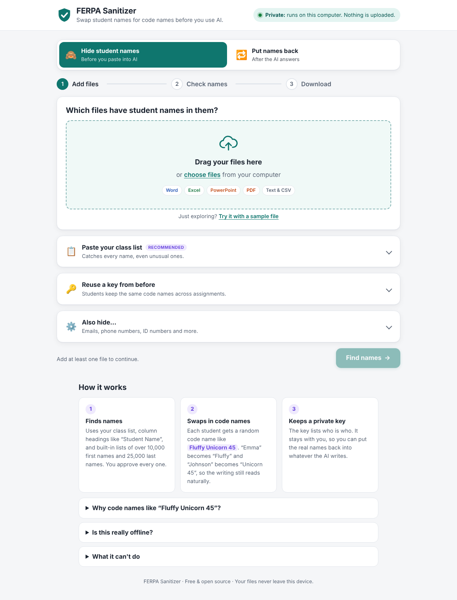
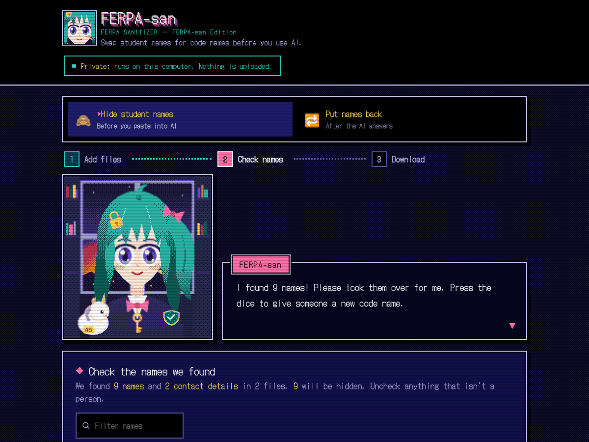

# FERPA Sanitizer

**Hide student names in your real Word, Excel, PowerPoint and PDF files before you use AI. Then put the real names back.**

[](https://mrperryai.github.io/FERPASan/)
[](https://mrperryai.github.io/FERPASan/)
[](https://mrperryai.github.io/FERPASan/FERPA-Sanitizer.html)

[](https://github.com/MrPerryAI/FERPASan/actions/workflows/pages.yml)

`Emma Johnson turned in her essay.` → `Fluffy Unicorn 45 turned in her essay.`

## Works on your real files, not just pasted text

Most anonymizers make you copy and paste text. FERPA Sanitizer opens the actual file, swaps the names, and hands you back the **same kind of file** with everything else untouched.

| File | What gets cleaned | What stays exactly the same |
|---|---|---|
| **Word** (.docx) | Body text, tables, headers and footers, footnotes, comments, tracked changes, text boxes, picture alt text, file properties | Fonts, formatting, layout, images |
| **Excel** (.xlsx) | Cells, "Student Name" / "First Name" / "Last Name" columns, sheet names, comments, chart labels, student ID numbers | Formulas (updated to match), formatting, other sheets |
| **PowerPoint** (.pptx) | Slides, speaker notes, tables, comments | Design, animations, images |
| **PDF** | All the text | Saved as a clean .txt file, which is what AI tools read best |
| **Text / CSV** | Everything | Structure and columns |

Plus:
- 🔒 **Private.** It runs entirely in your web browser. Nothing is uploaded, and it works with Wi-Fi off.
- 🔑 **Reversible.** A private **key** turns the code names in the AI's answer back into real names, in pasted text or in a whole file.
- 📅 **Consistent.** Reuse your key and each student keeps the same code name week after week.
- 🧑‍🏫 **Made for teachers.** Three steps, no install, no account. Free and open source.

## Get it

**Easiest:** go to **[mrperryai.github.io/FERPASan](https://mrperryai.github.io/FERPASan/)** and click **Download**. Save the file to your Desktop and double-click it whenever you need it. It works with no internet connection.

You can also click **Open in browser** on that page and use it right there. That's private too: your files are processed on your computer, not on a server.

### Two editions

Both editions do exactly the same thing. Pick the one you like.

| Standard Edition | FERPA-san Edition |
|---|---|
| [](https://mrperryai.github.io/FERPASan/) | [](https://mrperryai.github.io/FERPASan/) |
| Clean and calm. Light and dark mode. | A PC-98 style visual novel. FERPA-san, the school's privacy librarian, walks you through each step. |

**Meet FERPA-san.** She has teal hair, a padlock hair clip, and a golden key on her ribbon. Her plush, Fluffy Unicorn #45, rides on her shoulder. Her picture is drawn fresh on your computer: the vector art is shrunk and reduced to a 16-color PC-98 palette with ordered dithering. Her expression changes as you work. She thinks while she scans, beams when she's done, turns serious about your key, and sweats if something goes wrong.

---

## How to use it

### Hide names (before AI)

1. **Add files.** Drag your Word, Excel, PowerPoint, PDF or text files onto the page.
   - *Recommended:* open **"Paste your class list"** and paste your roster, one student per line. The tool then catches every name, even unusual ones.
2. **Check names.** The tool shows every name it found, the code name it will use, and a snippet of where it appeared.
   - Uncheck anything that isn't a person.
   - Names that are also everyday words (*Will*, *Grace*, *Hunter*) are flagged for a double-check.
   - Famous people and book characters (*Abraham Lincoln*, *Atticus Finch*) are listed but left unchecked, so essays about them aren't changed.
   - Missed someone? Type their name in **"Missed someone?"**
   - Don't like a code name? Click 🎲 to pick another.
3. **Download.**
   - Download the **-sanitized** files. These are safe to give to AI.
   - Download the **key** and keep it private. **Never upload the key to an AI tool.**

### Put names back (after AI)

1. Click **Put names back** at the top.
2. Add your key (if you just made one, it's already loaded).
3. Paste the AI's answer, or drop in a file it gave you. Real names appear right away. Click **Copy text** or **Download**.

### Reuse the same code names next week

On the first screen, open **"Reuse a key from before"** and choose your old key. Each student keeps the same code name, and everyone in that key is recognized automatically.

---

## How code names are chosen

Each student gets a code name like **Fluffy Unicorn 45**:

| Real | Code name | Why |
|---|---|---|
| Emma Johnson | Fluffy Unicorn 45 | Full name → full code name |
| Emma | Fluffy | First name alone → the silly word |
| Johnson | Unicorn 45 | Last name alone → creature + number |
| Johnson, Emma | Unicorn 45, Fluffy | Gradebook order is kept |
| Mrs. Johnson | Mrs. Unicorn 45 | Family members share the creature, like a real family name |
| emma.johnson@school.org | fluffy.unicorn45@example.com | Emails, phone numbers and student IDs are replaced too |

- **Random.** Code names are picked at random and don't use initials, so they reveal nothing about the student.
- **Consistent.** The same student gets the same code name across every file you process together, and across weeks if you reuse your key.
- **Easy to reverse.** Whimsical words like "Fluffy" or "Zesty" almost never appear in schoolwork, so putting real names back is accurate. Words that already appear in your files are never used as code names.
- **The number keeps students apart**, even when two code names look similar.

## How names are found

1. **Your class list** (most accurate) and any **key** you loaded.
2. **Column headings** in spreadsheets and tables, such as "Student Name", "First Name", "Last Name" or "Parent/Guardian".
3. **Ordinary sentences**, using built-in lists of **10,000+ first names** (US Social Security baby names plus other open datasets) and **25,000 last names** (US Census 2010). The tool also catches:
   - the last name after a first name ("Emma Johnson", "Maria de la Cruz")
   - titles ("Mrs. Okafor", "Dr. Patel")
   - gradebook order ("Johnson, Emma")
   - unfamiliar first names before a common last name ("Oluwaseun Adams")
4. **Contact details:** email addresses, phone numbers, and student ID numbers (6–10 digits). Each can be turned off under **"Also hide…"**.

It also knows what *isn't* a name: everyday words ("Noah's **Math** homework" isn't "Noah Math"), place names ("New York", "Los Angeles"), and famous people.

After making the files, the tool **re-reads the finished files** and lists anything that still looks like a name, so you can go back and add it.

## What it can't do (yet)

| Limit | Why, and what to do |
|---|---|
| Text inside **pictures**, screenshots or scanned pages | Reading pictures (OCR) would add roughly 15 MB to the file. The tool warns you when a file has pictures, so you can check them yourself. |
| A PDF's **layout** | PDFs come out as a clean **.txt** file. That's what AI tools read best anyway. A scanned PDF has no text to read. |
| Old **.doc / .xls / .ppt** files | These old binary formats can't be edited safely in a browser. Use *File → Save As* to make a .docx/.xlsx/.pptx (the tool shows you how). For Google Docs, use *File → Download → Microsoft Word*. |
| Perfection | **Always skim the sanitized file before you share it.** This tool helps you follow FERPA, but it is not legal advice. |

---

## For developers

No frameworks, no server. Plain HTML, CSS and JavaScript.

```
index.html             The page (loads css/, js/ and vendor/ separately, handy while editing)
css/styles.css         Styles: Standard (light/dark) + FERPA-san Edition (PC-98 theme)
js/zip.js              Tiny ZIP reader/writer using the browser's built-in CompressionStream
js/names-big.js        GENERATED name lists (see tools/build-names.py)
js/names-data.js       Hand-picked lists, everyday-word names, code-name word lists
js/engine.js           Name detection, code names, find/replace matcher, key CSV
js/office.js           Reads and rewrites .docx/.xlsx/.pptx XML, PDF text, text/CSV
js/mascot.js           FERPA-san: vector art, PC-98 dithering, visual-novel dialogue
js/app.js              The screens and buttons
vendor/pdfjs/          pdf.js 3.11 legacy build (Apache-2.0)
vendor/fonts/          DotGothic16, Latin subset (SIL OFL), FERPA-san Edition only
tools/build.mjs        Bundles everything into the two single-file editions
tools/build-names.py   Downloads the public datasets and regenerates js/names-big.js
site/index.html        The GitHub Pages landing page with the download buttons
.github/workflows/     Builds both editions and deploys the site on every push to main
```

**Rebuild the single files after editing:**

```bash
node tools/build.mjs          # writes both editions
python3 tools/build-names.py  # only if you want to refresh the name lists
```

Commit the rebuilt `FERPA-Sanitizer*.html` files along with your changes. The **Build and deploy** workflow rebuilds them on every push and pull request, and fails if the committed copies are out of date. On `main` it then publishes the landing page and both editions to GitHub Pages.

While you work, open `index.html` directly in a browser. Add `?edition=ferpasan` to the address to see the FERPA-san Edition. The scripts are classic (non-module) on purpose, so everything runs over `file://`.

**Technical notes**

- Word often splits one word across several formatting "runs" (`<w:t>Em</w:t><w:t>ma</w:t>`). Text is matched per paragraph, then the edits are mapped back onto the original runs, so formatting is kept.
- Also covered: headers, footers, footnotes, comments, tracked deletions, text boxes, alt text, document properties, Excel shared strings, sheet names, formulas, comments, chart labels, pivot caches, `mailto:` links, and student IDs stored as numbers.
- Unchanged parts of the ZIP (images and so on) are copied byte-for-byte.
- pdf.js runs on the main thread (its worker script is included as a normal script), so PDFs work even from a double-clicked file.
- Code names use `crypto.getRandomValues`.
- The key is a CSV file (`Type, Real name or info, Code name`) that opens in Excel. Lines starting with `#` are comments.

**Custom FERPA-san art.** Got commissioned art? In `js/mascot.js`, set `MASCOT_IMAGES` to one picture per mood (`happy`, `cheer`, `think`, `proud`, `serious`, `oops`, `wink`) as data URLs. They go through the same PC-98 dithering. Or replace `MASCOT_SVG` and keep its mood groups.

## Credits and licenses

- FERPA Sanitizer: MIT. See [LICENSE](LICENSE).
- [pdf.js](https://github.com/mozilla/pdf.js) by Mozilla: Apache-2.0 (`vendor/pdfjs/LICENSE`).
- [DotGothic16](https://github.com/fontworks-fonts/DotGothic16) by Fontworks: SIL Open Font License (`vendor/fonts/OFL.txt`).
- First names: US Social Security Administration baby names (public domain, via [hadley/data-baby-names](https://github.com/hadley/data-baby-names)) and [@stdlib](https://github.com/stdlib-js/stdlib) first-name datasets (Apache-2.0).
- Last names: US Census Bureau 2010 surnames (public domain).
- Everyday-word lists: [SCOWL](http://wordlist.aspell.net/) via [wordlist-english](https://www.npmjs.com/package/wordlist-english).
